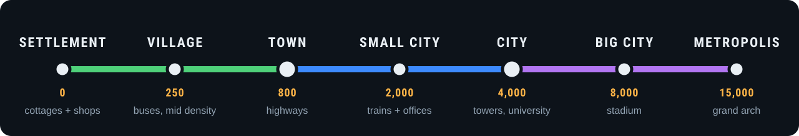

<p align="center">
  
</p>

<p align="center">
  <a href="https://kostslava.github.io/open-skylines/"></a>
</p>

## what is this

a city builder you play in the browser. it's kinda like cities skylines 2 but way smaller and simpler, made in three.js. nothing to install, just open the link.

you start off a highway with an empty island, lay some roads, zone stuff, and buildings show up when people actually want to live or work there. every car is its own agent driving its own route, so if you build a dumb intersection you'll watch it jam up. grow the population and you unlock bigger buildings, buses, trains, and eventually towers.

water and power are automatic because managing pipes is boring.

## how the city grows

<p align="center">
  
</p>

each milestone gives you some cash and unlocks new stuff:

| milestone | pop | unlocks |
|---|---:|---|
| settlement | 0 | small roads, avenues, low density homes and shops, industry, basic services |
| village | 250 | medium density homes, bus lines, town plaza |
| town | 800 | highways, high density commercial, high school |
| small city | 2,000 | trains and metro, offices, hospital, police HQ |
| city | 4,000 | high density homes, university, central park |
| big city | 8,000 | stadium, observation tower |
| metropolis | 15,000 | grand arch |

## what's in it

- **zoning.** residential, commercial, industrial and office. buildings level up as land value goes up
- **traffic.** cars pathfind with A*, pick lanes, follow each other and queue at junctions. the traffic view shows you where it's jammed
- **transit.** bus lines and train/metro lines, elevated or underground. people walk to stops, transfer, and pay fares
- **services.** police, fire, health, schools, garbage, parks. each one covers a radius and sends its own vehicles out
- **money.** taxes per zone, upkeep, and loans if you go broke
- **the rest.** day/night cycle, info views for basically everything, and residents who complain about stuff

## controls

| key | does |
|---|---|
| <kbd>W</kbd> <kbd>A</kbd> <kbd>S</kbd> <kbd>D</kbd> | move camera, hold <kbd>Shift</kbd> to go faster |
| <kbd>Q</kbd> <kbd>E</kbd> | rotate |
| <kbd>R</kbd> <kbd>F</kbd> | zoom in / out |
| <kbd>T</kbd> <kbd>G</kbd> | tilt |
| right drag | rotate + tilt |
| middle drag | pan |
| scroll | zoom |
| <kbd>Space</kbd> | pause |
| <kbd>1</kbd> <kbd>2</kbd> <kbd>3</kbd> | game speed |
| <kbd>B</kbd> | bulldoze |
| <kbd>R</kbd> | rotate a building before you place it |
| <kbd>Esc</kbd> | cancel tool |

## if it's your first city

1. build a small road off the highway. roads that aren't connected to it don't count
2. drag zones along the road and watch the R / C / I demand bars at the top
3. people need jobs and shops, and industry is loud, so don't put it right next to houses
4. if stuff feels slow open the traffic view. red roads are jammed, so add an avenue, another route, or a bus line
5. get a clinic and a fire station early, fires will wreck you otherwise

## graphics

there's a quality dropdown on the start screen (low, medium, high, ultra) and you can change it in settings whenever. low is for older laptops and integrated graphics, ultra is for a real gpu.

## running it locally

just clone it and open `index.html` in chrome, edge or firefox. you still need internet because three.js and the fonts load from a cdn.

```bash
git clone https://github.com/kostslava/open-skylines.git
```

your city saves in your browser. it autosaves every in-game month, or hit settings → save now. saves don't carry over between computers.

`dist/arterial.html` is the whole game in one file. if you edit anything in `js/`, rebuild it with:

```powershell
powershell -File build.ps1
```

## code

no framework, no bundler. just plain scripts loaded in order that share one global `CB` object.

| file | what it does |
|---|---|
| `js/core.js` | constants and balance: roads, zones, services, milestones, quality presets |
| `js/world.js` | tile grid and terrain gen (island, river, mountains) |
| `js/gfx.js` | renderer, lighting, day/night, sky, water, terrain, camera, picking |
| `js/meshes.js` | procedural buildings, roads, rail, trees, vehicles |
| `js/traffic.js` | A* routing, lanes, car following, junction queues, congestion |
| `js/transit.js` | stops, bus and metro lines, passenger routing, trains |
| `js/sim.js` | growth, demand, jobs, happiness, services, fires, garbage, money, milestones |
| `js/tools.js` | input and build tools |
| `js/ui.js` | panels, info views, goals |
| `js/main.js` | boot, main loop, save/load |

<details>
<summary><b>debug url params</b></summary>

<br>

| param | does |
|---|---|
| `?demo=1&ms=4&ff=72` | builds a demo town, unlocks up to milestone 4, fast forwards 72 game hours |
| `&preset=low\|medium\|high\|ultra` | forces a graphics preset |
| `&hour=21` | sets the time of day |
| `&ov=traffic` | opens an info view on load |

</details>
